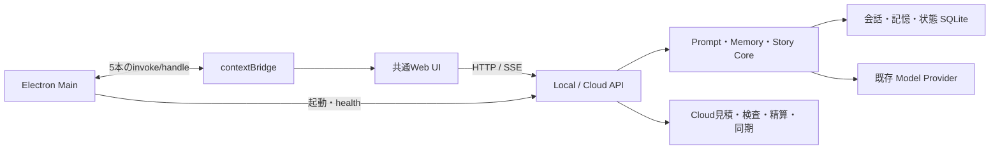

# 2026-10-11 競合比較に向けた実装と受け入れ境界

更新日：2026-10-11。対象は開発チェックアウトのKyaluluと、zeta／ISEKAI ZEROの公開調査資料。
今回の改善ソースは**本番未配布**。機能・性能・運用の全面同等を達成したという報告ではない。
ソース実装、Mock／単体検証、競合の公開観測、実サービスの受け入れを別々に記録する。
累計API実費上限は**$0.10を維持**し、今回の実装・検証での有料API実行は**0**。
現在残額は過去の残額から推定せず、実送信前に台帳と未確定予約を確認する。

## 判定と証拠の読み方

- 「実装のみ」：対応ソース・操作経路がある。利用可能な接続先、保存、失敗、再開の実操作受け入れは別。
- 「確認済み」：取得日・ソース・条件・操作・結果・証拠を特定できる範囲だけ。過去の成功を改修後の成功へ転用しない。
- 「未確認」：実会話、プラン別利用、端末・運用等を観測していない。未確認を合格に繰り上げない。
- 「不足」：初期無効、未実装、実測不足等で計画の条件を満たしていない。対象外なら理由を残す。

機能同等、性能同等、運用同等はすべて未判定。無料／有料、日常会話／物語、Cloud／ローカル／BYOK、
同じ設定／各製品の標準体験を混ぜず、zetaとISEKAI ZEROに対してそれぞれ評価する。
作品数・利用者数・作者収入の実績を、実装された機能の証明に使わない。

## 競合の公開資料とREA証拠

比較計画に記録された公開画面・公式資料・配信コードの観測を出発点とする。
この文書更新で競合へログイン・会話生成・購入・投稿・公開は行っていない。

| 対象 | 公開参照先 | 観測の用途・限界 |
|---|---|---|
| zeta | [日本語サイト](https://zeta-ai.io/ja)、[Privacy](https://zeta-ai.io/en/policy/privacy)、[Partner](https://zeta-ai.io/en/policy/partner) | 発見、作品、創作、料金・作者還元・データ方針の比較基準。実会話・有料操作・契約の現時点の実適用は未確認 |
| ISEKAI ZERO | [サイト](https://www.isekaizero.ai/)、[料金の透明性](https://docs.isekaizero.ai/books/transparency/page/transparent-pricing)、[要約・Arc](https://docs.isekaizero.ai/books/your-guide-to-isekai-zero/page/summarization-and-arc) | 世界・物語、要約、モデル階層、費用の比較基準。紹介された機能の実効性とプラン別制限は未確認 |

公開配信コードの取得日は2026-10-11。
[取得元URL・ファイルhash一覧](../../.artifacts/parity-20261011/competitor-source/sources.json)は
公開クライアントの一部だけを対象にする。非公開Backend・保存基盤・学習方式の観測ではない。

| 対象 | 保存証拠／summary evidence ID | 親解析のevidence ID | 静的解析の範囲 |
|---|---|---|---|
| zeta | [rea-zeta.json](../../.artifacts/parity-20261011/rea-zeta.json) / `ev_c5f3c9bd5c7b7d478a9d4e1afb217a65f0980668dd4c5f5197d340df6e2aeaac` | `ev_79bad00eb3c7078e6360d73dc5be61b3d0f3be95c1c63d7c6cd1eb780dc18f69` | 67ファイル、parse failure 0。application／semanticともpartial、semantic truncated=true |
| ISEKAI ZERO | [rea-isekai-zero.json](../../.artifacts/parity-20261011/rea-isekai-zero.json) / `ev_3e766527b152c486e60ba7c12fbcf0e15377c7a2f7621c510961bc3df32a2860` | `ev_88b8ab83600016f581c8339fd7afcf73995eb467ad7b808f9955ca385b611b6c` | 5ファイル、parse failure 0。application／semanticともpartial、semantic truncated=true |

REAはJavaScriptを実行せず静的に解析した。summary viewの`complete-within-view`は親解析の完全性を意味しない。
資源制約・未解決の関係が残るため、検出0件を「機能／通信が存在しない」と読まない。
クライアント内の文字列・経路候補だけで提供機能や品質を確定しない。
[比較台帳](../../.artifacts/parity-20261011/ledger-final.json)の`rea_browser_observed=false`は維持する。
REAでのブラウザー通信観測と、本人の実会話・保存・再開の操作証拠はまだない。

## 20比較領域の現在地

競合欄は依頼計画に記録された公開観測・資料上の比較対象。配信コード由来の候補は提供確定を意味しない。
全行で競合の実会話・有料利用は未確認。Kyalulu欄は今回または既存ソースの実装であり、本番提供実績ではない。

| #／領域 | zeta：公開観測・比較対象 | ISEKAI ZERO：公開観測・比較対象 | Kyalulu：ソース上の対応・残る不足 |
|---|---|---|---|
| 1 初回体験 | 発見→会話の導線 | 世界・作品→開始の導線 | 既存認証・モデル接続、capabilities取得、一覧失敗／認証不足を空と区別。本人の初回操作・再開は未確認 |
| 2 発見・検索 | ランキング、推薦、タグ | 作品・キャラ探索 | 個人catalogの検索、公開catalogのq／tag、タグ・紹介文等の語句一致による関連作品。人気実績は捏造しない。公開catalogは既定無効 |
| 3 作品詳細 | 導入、作者、反応、類似作品 | キャスト、媒体、設定、トークン情報 | 固定公開版、作者、反応実数、公開設定、コピー保存→会話。候補なしの関連作品表示。操作受け入れは未確認 |
| 4 キャラ品質 | 口調、人格、感情、関係性 | 人格・世界内の役割 | 既存Compiler／記憶と評価台本。本体adapter追加。自然さ・キャラ崩れ・架空の過去の改善効果は未測定 |
| 5 物語品質 | プロットと会話 | 複数人物、展開、選択 | castの設定・知識・関係を文脈へ統合。一生成で複数人物を描写する基盤。因果・人物分離・ユーザー行動尊重の品質は未確認 |
| 6 長期会話 | lorebook等の対象、実効性未測定 | chapter／arc要約の説明 | 20メッセージごとのchapter、10chapterごとのarcを抽出式で保存。30／50／100ターンの実モデル比較は未実施 |
| 7 記憶管理 | 利用者が確認・編集できる範囲 | 要約・codexの編集 | 出典4分類、引用・版・発言ID、world固定scope、旧scope維持、プレビュー付き明示コピー移行、訂正・削除。supportedは語句一致であり事実証明ではない |
| 8 会話操作 | 編集・再生成・複製等の操作候補 | 編集・モデル切替等の操作候補 | Cloud再生成、inline quote、旧返信保持、履歴版、要約編集、分岐、完全消去。Cloud候補生成は未対応として無効 |
| 9 世界・ルール | lorebook、VN関連の対象 | Dungeon Mind、dice、状態 | castと宣言的RPG、サーバーdice／HP／所持品／技能。triggerは発言全文との完全一致。任意コード実行は未対応 |
| 10 創作・版管理 | 作成、非公開、編集 | シナリオ、関数、codex、変更履歴 | 既存編集・プレビュー・下書き・Portable固定版、世界設定のcast／RPG編集。native同一versionでの内容差し替えは固定保証なし |
| 11 モデル選択 | 提供範囲・制限の比較対象 | Free／Standard／Premium | capabilitiesでlocal／cloud-routesを分離。現行Cloud固定経路、ローカル・BYOK維持。別モデルの品質／原価比較は未実施 |
| 12 表現・媒体 | 画像、VNの提供範囲 | VN、画像、動画、音声、音楽 | VN・所有画像、ローカルWAV／MP4持込、WAVの音楽用途、再生autoplay=false。Cloud非画像保存は未対応、媒体生成=false、実codecは未確認 |
| 13 交流 | follow、コメント、反応 | follow、コメント、保存等 | 作者、follow、like／save、コメント、通報、block、取り下げの共有catalog/API/UI。承認条件を満たすまでcommunity=false |
| 14 作者経済 | Piecesによる報酬の説明 | 利益部分からの作者還元の説明 | 原価控除後の整数分配sandboxのみ。価格・還元率・権利・税・現金支払条件・実決済は未確定／未確認 |
| 15 料金・原価 | 広告、Pass、Pieces | Mana／Arcane、従量制 | 既存見積・予約・精算、安全検査・再生成原価、送信先／上限の毎回同意。今回有料API0。実請求照合と競合の同条件費用は未確認 |
| 16 モバイル | Webとアプリの差 | Webとアプリの差 | 既存PWA／レスポンシブUI。今回のAndroid IME・画面ロック・回線切替・PWA更新の実機確認は未実施 |
| 17 データ所有 | 保存・学習利用・削除条件 | 保存・要約・削除条件 | Portableの未知項目保持、Inspector、履歴／記憶／完全消去の区別、復元時の削除反映経路、当該端末の下書き・返信案消去。外部アプリ往復と他端末コピーの消去は未確認 |
| 18 信頼性・運用 | 混雑、制限、エラー処理の対象 | 混雑、制限、エラー処理の対象 | UUID再送、保存版競合、progress、Backend段階計測、client計測、エラー区別。実負荷・24時間・10人72時間・本番復旧は未受け入れ |
| 19 安全性・アクセシビリティ | 通報、block、利用条件 | 年齢区分、通報、利用条件 | SFW・owner分離、未検査Cloud本文非表示、承認flag、権利確認、明示同意、キーボード操作。実安全精度・アクセシビリティの全面受け入れは未確認 |
| 20 配布・導入 | ブラウザー・アプリ | ブラウザー・アプリ | Windows／Cloud候補の作成、NodeだけのPATHと隔離データで実npm CLIの起動・再起動・更新失敗・復元・rollbackを確認。クリーンOS・公開初回download・本番更新は未実施 |

## 実装の契約と限界

### 記憶・文脈・状態

[memories](../../runtime/python/storage/memories.py)と[Memory core](../../runtime/python/core/memory.py)は
`user_statement`（ユーザー発言）、`user_correction`（訂正）、`work_setting`（作品設定）、
`story_event`（AIの創作上の出来事）を区別する。AIの創作を本人の過去・好みの証明にしない。
`supported`の互換フィールドは残し、UIでは語句一致の参考として説明する。

新規scopeはキャラ・persona・world・library binding・設定versionを含むidentityに基づく`work:`。
保存済みの旧scopeは維持し、自動削除・自動複製しない。プレビューrevision確認後の明示移行でコピーし、
世界共有の変更は利用者が選ぶ。Portableの固定revisionと、native YAMLのversion記述は別の保証であり、
**native同一versionの内容変更は内容hashによる固定を保証していない**。

[conversation](../../runtime/python/storage/conversation.py)のchapter／arcは**抽出式の bounded excerpts**。
意味理解による生成要約や、重要事項を完全保持する要約ではない。追加推論費用は0。
出典発言ID・revision・methodを保存し、UIの訂正は`expected_revision`で競合を拒否する。
Cloudは`context_mode:'stored'`、`history_revision`、最新user発言からサーバーで履歴を組み立てる。
コンテキスト予算内の圧縮が、長期整合の品質同等を証明するわけではない。

[Story core](../../runtime/python/core/story.py)はtriggerと最新発言をcasefold／strip後に完全一致比較する。
部分一致、自然言語での任意行動理解、外部関数実行ではない。diceは生成の再試行で振り直さず、確定保存と連動する。
UIの説明も「発言全文との完全一致」へ修正した。

### Cloud・機能対応・計測

[capabilities](../../runtime/python/api/capabilities.py)のschema_version=1で対応操作を返し、UIは取得失敗時に推測で有効化しない。
[Cloud generation](../../runtime/python/cloud/generation.py)の再生成は既存見積・安全検査・生成記録・精算経路に接続し、
成功まで元の返答を保持する。候補生成はCloudでfalse。
[inline quote](../../apps/web/src/components/CloudQuoteConfirmation.tsx)は毎回の送信先・上限・条件を示す。
cancel／expiry／account switch／unmountでは拒否し、自動再送しない。

安全なprogressはqueue／input_safety／generation／output_safety／saveのみ。未検査本文は流さない。
Backendの`cloud_stages_ms`は段階の処理時間で、liveのsaveはcommitを含む。保存結果の再取得にある
`save_processing_ms`は別指標として読む。
[client timing](../../apps/web/src/lib/clientTimings.ts)は`performance.now()`による文脈取得、見積取得、同意待ち、
POST→最初の本文通知、POST→全文完了通知を`client_timings_ms`へ分離保存する。
本文通知はUIへの引き渡し時刻で、paintや推論TTFTではない。Cloudの安全確認後の一括表示をtoken streamingと扱わない。

### Community・持込媒体・Portable・配布

[Cloud app](../../runtime/python/cloud/app.py)のcommunityは
`KYALULU_COMMUNITY_APPROVED && legal_approved && !private_test`の場合だけ有効。既定無効。
明示公開したSFW characterの固定版のwhitelistを共有し、private profile／履歴／assets／source／未知項目は公開文書から除く。
作者IDはpublic hash、反応数は実数。公開・コメントのSFW検査は費用が発生し得るため明示確認し、自動実行しない。
コメントの任意`request_id`はUUID。同画面・同本文の失敗後再送に保持し、duplicate時の再検査回避をBackendと接続する。
ブラウザー再読込をまたぐコメントUUID保持はこのUIでは保証していない。

[媒体検査](../../runtime/python/core/portable_assets.py)はローカルWAVを標準waveで検査し、MP4はISO container構造と外部参照を検査する。
[upload API](../../runtime/python/api/library.py)は非画像に`rights_confirmed=true`を要求し、32MiBまで。
MP4のcodec実再生はブラウザー側で判断し、構造検査の成功だけでは再生保証にならない。
[PortableEditor](../../apps/web/src/components/PortableEditor.tsx)は権利確認とWAV／MP4 input、
[PortableMedia](../../apps/web/src/components/PortableMedia.tsx)はautoplay=falseと再生エラー表示を接続する。
Cloudの非画像保存は未対応。Cloud画像も安全精度・原価の受け入れまでgateを維持し、媒体生成はfalse。

Portableのimport／export・未知項目保持とInspectorは既存基盤を再利用した。
外部アプリとの実往復・全形式互換は未確認。完全消去はBackend本文・生成結果・関連記憶と当該端末の下書き・返信案を区別して扱う。
書き出し済みファイル、他端末のコピー、バックアップ保持方針を自動消去済みとしない。金額台帳は本文と分離して保持する。

[作者経済sandbox](../../runtime/python/cloud/creator_economics.py)は原価と分配率を明示入力する整数シミュレーションのみ。
wallet変更、販売、実支払、商用価格決定は行わない。
[npm manifest準備](../../scripts/prepare_npm_manifest.mjs)は対象実機・license承認済みのWindows／Apple Silicon配布物を要求する。
スクリプトがあることを公開manifest完成・クリーンOS合格・npm公開と扱わない。

## 本体評価adapter・比較bootstrapの基盤

[kyalulu_bridge.py](../../benchmarks/characterbench/tools/kyalulu_bridge.py)は参考`system_bridge.py`と別の本体KCB System adapter。
明示したloopback Runtime、隔離された`kcb:`セッション、保存文脈・状態・記憶、決定的generation ID、step再取得を通す基盤である。
importするだけでモデルを起動・呼び出さない。実モデル・Cloud・競合の品質判定を実施した証拠ではない。
実サービスの認証・費用同意をこのローカルadapterで代替しない。

[competitor_parity.py](../../scripts/competitor_parity.py)は自作12キャラ（日常6／物語6、各5ターン）、
日常2／物語2の30／50／100ターン×3反復、development／acceptanceの分離、20領域×3製品の台帳を準備する。
比較用の生成・競合APIアクセス・費用発生は行わない。全試行と失敗・制限・条件差を記録して比較する。
同条件plan／settingごとの集計、キャラ単位のpercentile bootstrap（固定seed、2,000再標本化）の95%下限、
各キャラ3人以上・12キャラの人手評価、各arm100件以上のp50／p95、失敗率のWilson区間、費用の完全性を分ける。
Mock／保存応答のreplayは実性能集計から除外し、AI採点を正式人手判定の代用にしない。
開発用とは発言内容・IDを分けた短期12キャラ／長期12条件のheld-out台本を用意した。
正式集計には`split:'acceptance'`を明示した観測だけを使い、開発用・split不明の観測を除外する。
品質差の下限−0.2、速度比1.2、失敗率目標1%、重大不整合0件という事前基準を、観測後に都合よく変更しない。

[最新fixtures](../../.artifacts/parity-20261011/evaluation-final/fixtures.json)、[60項目の台帳](../../.artifacts/parity-20261011/ledger-final.json)、
[acceptance](../../.artifacts/parity-20261011/evaluation-final/acceptance.json)を使う。旧fixturesは初期資料として保持する。
実観測がないので競合比較はpending／unverified。KCB同梱configは`mock-echo`を明示し、実モデルのIDと混同しない。
adapterは推論トークンの既知値をKCBの`completion_tokens_details.reasoning_tokens`契約へ接続し、不明値を0へ置換しない。
推論が観測されないことや、no-thinking設定の検証成功をこのadapterのSmokeだけで主張しない。
一部条件の合格や総合点で機能・性能・運用の不足を隠さない。

## 構造・依存関係と通信の位置

通常のソース構造はリポジトリを直接確認し、競合の公開配信コードにはREAを用いた。
今回の共通UIは`apps/web`（React／TypeScript）、契約は`packages/schemas`とPythonのPydantic、
HTTP境界はFastAPI、保存はSQLite／aiosqlite、モデル通信は既存Providerを使う。依存追加・lockfile変更なし。

DesktopのIPCは`get-app-path`、`get-api-base`、`check-python-health`、`get-le-status`、`get-supervision`。
preloadとMainの対応を静的に確認した。会話本文はこれらのIPCへ載せず共通HTTP APIで処理する。
今回DesktopのIPC追加はない。実Electronの受け入れは過去記録と区別し、今回の実機受け入れへ繰り上げない。

## 統合レビューで解消した不整合

- 記憶を先に消した後の完全消去でも、保存traceの`source_session_id`から他会話の引用・生promptを除去。
- 同一保存DBでpending生成中の完全消去を拒否。Cloud準備前の消去版をCore予約の書込transaction内で照合し、準備中に削除が起きた生成を外部送信前に409で止め、予約費用を0で解除する。
- `memory.trace.retrieval_ms`を見積内容・上限計算から除外。同じ内容の処理時間差で見積りが無効にならず、記憶の内容変更は新しい見積りを要求する。
- native設定の版チェックをmemory OFFでも実施。Cloud／Local、client／storedの各経路を検証。
- 同期の旧記憶5追加列・scope `branch`・重複tombstoneを互換・冪等に処理。不正な行は無視する前に拒否し、wire／hashは変更しない。
- 選択同期・ダウンロード採用・バックアップ復元にも削除記録を適用。他会話の引用・prompt・traceを原子的に除去し、選択外のローカル削除記録も保持する。
- 同期版の更新／消去後は旧ダウンロードのpageを409で停止。ローカル採用失敗時は本文とbaselineを保持し、最新snapshotで再開する。

## 計画の段階別の残り

| 段階 | 今回進めた範囲 | 未完了の条件 |
|---|---|---|
| 0 比較基盤 | 公開DOM・REA台帳、自作台本・held-out、本体adapter・正式判定gate | 本人ログイン済み競合での同設定の会話・保存・再開、3人以上の評価 |
| 1 Cloud基本 | capabilities、再生成、inline quote、安全progress・段階計測、状態別エラー | 実Cloud UI操作・品質・p95・請求照合 |
| 2 記憶 | 4分類、world scope、移行、出典、抽出式要約、保存文脈・消去反映 | 重要事項を意味的に保つ要約、30／50／100ターン実モデル3反復の品質 |
| 3 会話・物語 | cast、宣言的RPG、分岐・編集整合、Portable／Inspector導線 | 品質の同条件改善検証、native同version内容固定、外部アプリ往復 |
| 4 発見・交流・媒体 | 固定公開版のAPI/UI、検索・関連作品・交流、持込WAV／MP4、分配simulation | world／シナリオの公開catalog、実codec、媒体生成、決済・作者支払・公開運用 |
| 5 導入・運用 | Windows／Cloud配布候補、隔離PATHで実npm CLI | Mac／クリーンOS・実download、実機・負荷・24h／72h・本番配布 |

この表の未完了条件を、ソースやMockの合格で代替しない。

## 最終検証記録

2026-10-11に統合レビュー後のソースを再検証した。同時サブエージェントは最大2人。
過去の648／791／827件や初期配布候補は中間記録として保持し、以下へ加算・転用しない。
106警告はWebSocket／Uvicornの非推奨APIに関するもの。変更対象のRuff Fとdiff checkは通過。
全Runtimeを対象にした広いRuff Fでは、変更していない`api/presets.py`の既存未使用importが1件残る。

| 検証項目 | 最終結果・証跡 |
|---|---|
| 統合ソース指紋／Git | `b35bea30dcc9cd9cce8dd2533a1ff678d71cf0185ecc8dde18b04f9aac9c7e0a`。基準HEAD `22a4b313208eebd4921c2585a75f74dfe19d4ac9`、作業ツリーの未commit変更を含む。commit／pushなし |
| Python全体＋同梱KCB | **845 passed、2 subtests passed、106 warnings、431.14秒**。[全体ログ](../../.artifacts/parity-20261011/python-release.log) |
| Web／schema型検査・build | **21ファイル・147件成功**。[Webログ](../../.artifacts/parity-20261011/web-final.log)、[全workspace typecheck](../../.artifacts/parity-20261011/typecheck-final.log)、[Web build](../../.artifacts/parity-20261011/web-build-final.log)。既存の500KB chunk警告あり |
| CLI最小試験 | **17件成功**。[ログ](../../.artifacts/parity-20261011/launcher-final.log) |
| 本体adapter／比較集計 | 最終Python全体に含む。既知／不明の推論トークン、保存・記憶・再取得、正式split・bootstrap gateを検証 |
| 長期Mock本体 | **30／50／100ターン、合計180ターン**、各1反復・開発用1キャラ。履歴60／100／200件、chapter3／5／10、100ターンでarc1、最終step再取得は再生成なし。[REPORT](../../.artifacts/parity-20261011/system-smoke/REPORT.json)、[全turn](../../.artifacts/parity-20261011/system-smoke/turns.jsonl) |
| 配布候補監査 | [release-audit.json](../../.artifacts/parity-20261011/release-audit.json)。Cloud／Windowsとも対応ソース362ファイル、Runtime99ファイル、Web57ファイルの全対象をworkspaceと照合。Cloud内SHA256SUMS／Windows manifestのhashも一致 |
| 実npm tarball | [acceptance.json](../../.artifacts/parity-20261011/npm-release/npm-verify-zkkAEU/acceptance.json)。NodeだけのPATH・隔離データで起動、記憶再起動、backup／restore、rollback、不正restore、失敗update、pointer障害7条件を確認。**開発PC、clean OS=false、first download=false、実推論0** |
| 最終Mockブラウザー | 別の隔離Runtime `127.0.0.1:18792`、最終Web `index-B7qUtEyH.js`。Mock明示選択、送信、記憶の引用／発言ID／版、reload後の保存を確認。390×844／1440×900、light／dark、横overflowなし、console warn／errorなし |
| 本番配布・health・認証・rollback | 未実施／未確認：今回ソースは本番未配布 |
| 実費・未確定予約・台帳照合 | 今回有料API0、累計上限$0.10維持。現在残額は実送信前に照合 |

Pythonの実行は、Runtimeと同梱KCBを`PYTHONPATH`へ指定し、
`.venv/Scripts/python.exe -m pytest tests benchmarks/characterbench/tests -q -p no:cacheprovider`。
Webは`pnpm --filter web test`、`pnpm typecheck`、`pnpm --filter web build`。
最後に独立担当が元のCloud消去race・重複tombstone・旧記憶採用を再現条件で再確認し、8条件で解消を確認した。

長期Mockの最初のharnessはhistory APIの既定50件を見落とし、30ターン後の件数assertで失敗した。
そのログを保持し、明示limitで確認を修正、保存済みadapterのstepを再取得して続行した。
このlive Runtimeは最後のCloud予約guard／download互換修正前にimportされている。
REPORT内の`runtime_source_reference`と、最終ソースの全体試験・別Runtimeブラウザー証跡を分けて読む。
Mockの成功を実モデルの長期整合・品質・p95の受け入れに使わない。

最終候補のSHA-256：

| 候補 | SHA-256 |
|---|---|
| [Cloud](../../.artifacts/parity-20261011/cloud-release/kyalulu-cloud.tar.gz) | `4f01aa055c21e874b51bb51fc7f79fa51e41164ffedad32e0296884aef29ebb2` |
| [Windows](../../.artifacts/parity-20261011/windows-release/kyalulu-0.1.0-beta.1-win32-x64.tar.gz) | `c244d78654f1ceb6820fc6acbceb77d028d38d740a2b25fded527c27ed9e7fc2` |
| [npm CLI](../../.artifacts/parity-20261011/npm-release/npm-verify-zkkAEU/kyalulu-0.1.0-beta.1.tgz) | `7bd019a271f3284d2e5c3f9b80c8b95b9672f3b06423b49b62291aa63bc3d988` |

Windows候補は先行候補のhashを検証した同version interpreterとwheel cacheを再利用し、残りは正規builderをofflineで実行。
新しい配布候補には実機・license gateが未承認のまま記録される。正式npm manifestを公開済みとして埋めていない。
`candidate`／`final`／`verified`という先行ディレクトリは修正前の証跡で、今回の配布候補は`*-release`だけ。

ブラウザー証跡は[送信](../../.artifacts/parity-20261011/browser-release-chat.txt)、
[記憶出典](../../.artifacts/parity-20261011/browser-release-memory.txt)、[再読込](../../.artifacts/parity-20261011/browser-release-reload.txt)、
[390 light](../../.artifacts/parity-20261011/browser-release-390-light.png)、[390 dark](../../.artifacts/parity-20261011/browser-release-390-dark.png)、
[1440 light](../../.artifacts/parity-20261011/browser-release-1440-light.png)、[1440 dark](../../.artifacts/parity-20261011/browser-release-1440-dark.png)。
先行ブラウザーでは再生成・分岐・VNも確認した。PWAの「更新して再読み込み」は内蔵ブラウザーでタイムアウトし、
旧資産が残ったため更新成功にしていない。最終UIの確認には新しいportと別の隔離DBを使った。
実機PWA更新、IME、Cloud見積同意UI、実codecは未確認。

[最新の公開前audit](../../.artifacts/parity-20261011/release-readiness-final.json)は期待どおりexit 2。
実受け入れの未達をMockや候補hashで解除していない。

## 残る受け入れ

- 競合の本人ログイン済み無料範囲で実会話、編集・保存・再開。無料制限を回避しない。有料機能・実料金は別条件で確認。
- 共通設定と標準体験を分けた短期／長期会話、人手評価、実Cloud応答時間・成功率・原価。現予算で不足する判定は未判定のまま残す。
- 実機AndroidのIME・ロック・回線切替・PWA更新、Desktop、実ブラウザーのWAV／MP4 codec、アクセシビリティ。
- クリーンWindows／macOSのNode導入・初回起動・更新失敗・rollback・データ保持。未提供OSをMockで受け入れない。
- 外部アプリとのPortable往復、媒体権利・容量・Cloud画像安全精度、バックアップ・削除反映・他端末コピー。
- 本番配布、既存認証・同期・請求照合、負荷1→2→5→10、24時間、10人72時間、復旧、公開・販売・広告・Remoteの各承認。

次は予算・実機・配布条件を満たす範囲で、段階別の未完了条件を受け入れる。
各段階の測定→原因分類→改善→同条件再確認を続け、同等判定までは競合を超えたという結論を出さない。
